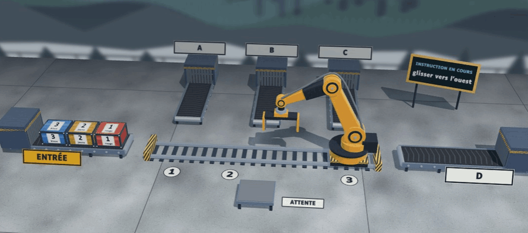
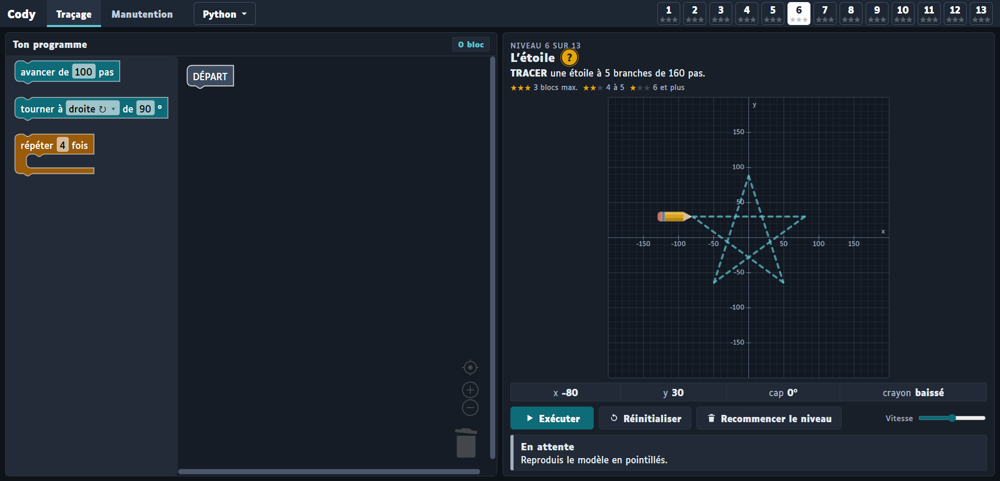
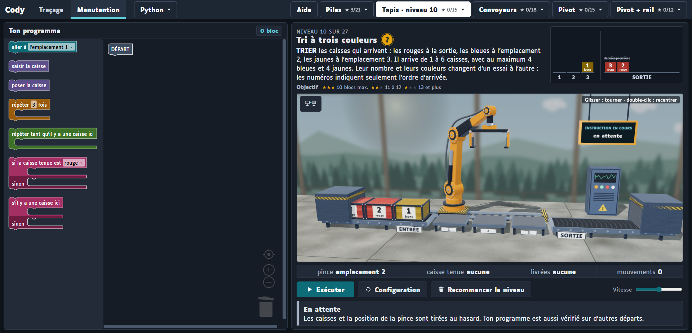
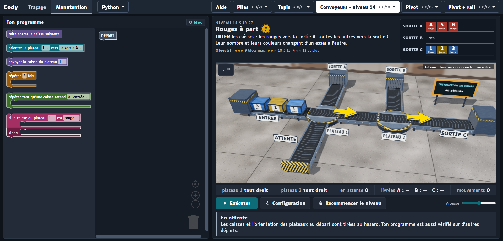
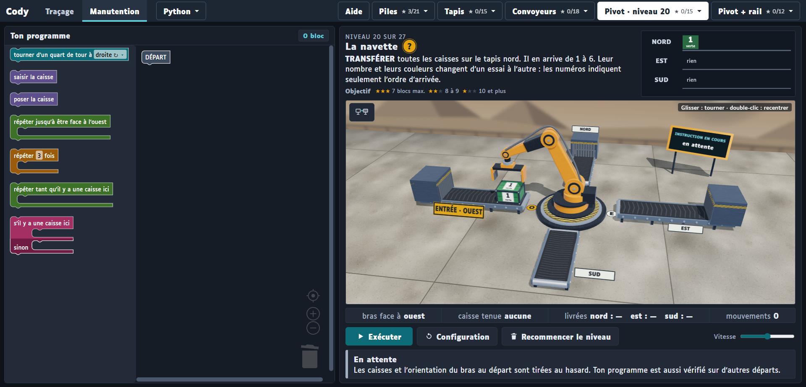
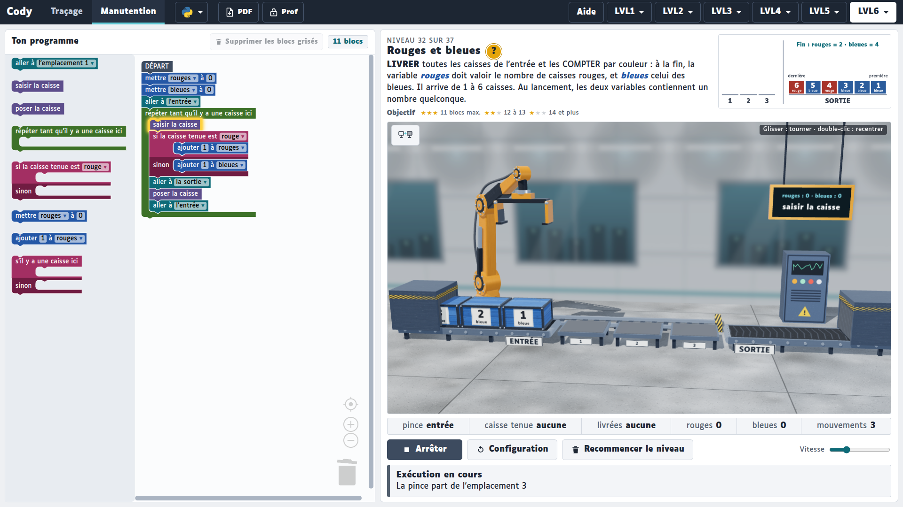

# Cody

Apprendre à programmer par blocs, pour des élèves de 3e et de Seconde (et au-delà).
Site entièrement statique : aucun serveur d'application, aucune base de données, aucun service
extérieur. La progression est enregistrée dans le navigateur.

## Ateliers

- **Traçage** : 13 niveaux, dont des niveaux à couleurs imposées et une création libre.
- **Manutention** : 37 niveaux en 6 groupes (menus LVL1 à LVL6) avec un bras robot (piles, tapis
  roulants), un centre de tri à plateaux tournants, puis un bras pivotant, sur place et sur rail, et
  enfin des **variables**
  (compter, décompter, répéter « variable » fois, comparer à un nombre ou entre elles : une ou deux
  par niveau). Les départs sont tirés au hasard : le programme doit gérer tous les cas ;
  « Configuration » en tire un autre, « Exécuter » joue celui qui est affiché.

Chaque programme peut être relu en Python (menu « Python » de la barre du haut).

Autres points :

- **3 étoiles** par niveau : moins le programme a de blocs, plus il en gagne ; écran de réussite.
- **Indice** : bouton « ? » à côté du titre du niveau, le texte s'ouvre au milieu de l'écran.
- **Suivi de l'exécution** : le bloc en cours est entouré de jaune ; quand le programme s'arrête sur
  une erreur, le bloc fautif clignote en rouge.
- **Supprimer les blocs grisés** : efface d'un clic les blocs non accrochés à DÉPART (Ctrl+Z les rend).
- **Variables dans les consignes** : leur nom est en italique et en couleur.
- **PDF** : l'élève exporte l'image de ses blocs avec le rappel du niveau (numéro, nom, consigne,
  barème) et l'adresse du jeu.
- **Espace prof** (bouton « Prof », mot de passe) : solutions d'un, de plusieurs ou de tous les
  niveaux de l'atelier, à **visualiser** à l'écran ou à exporter en **PDF** ; « Appliquer la
  correction » remplace le programme du niveau ouvert par la solution. Les solutions restent
  lisibles dans le code du site : à ne pas considérer comme secrètes.
- **Second écran** (Chrome, Edge, Brave) : la vue 3D de la manutention s'ouvre dans une fenêtre sur
  l'autre écran, ce qui laisse toute la place aux blocs.
- **PC modestes** : la 3D passe d'elle-même en mode léger (ombres plus simples, 30 images/s) si le
  navigateur dessine sans carte graphique ou si l'animation est trop lente. Sans carte graphique, un
  bandeau indique où activer l'accélération matérielle. Dans l'adresse : `?leger` force ce mode,
  `?complet` l'interdit, `?2d` remplace la 3D par un dessin plat.
- Pensé pour un PC en 1920 × 1080, en thème clair ou sombre, avec la police Luciole.

## Captures



*Niveau 26, « Un quai par couleur » : le bras sur rail trie six caisses, les rouges en A, les bleues en B, les jaunes en C (lecture accélérée ×2).*

| Traçage : l'étoile | Manutention : tri à trois couleurs (tapis) |
|---|---|
|  |  |
| **Centre de tri : rouges à part (convoyeurs)** | **Bras pivotant : la navette** |
|  |  |

**Variables : rouges et bleues** (niveau 32) — le programme compte chaque couleur dans sa variable ;
les valeurs s'affichent sur l'écran de la scène et dans le relevé.



## Inspiration

Cody s'appuie sur [**Blockly**](https://github.com/google/blockly) (Google) pour l'éditeur de blocs,
et sur l'idée du niveau « Tortue » de [**Blockly Games**](https://github.com/google/blockly-games)
(Google, Apache 2.0), elle-même héritée de la tortue du langage Logo. Aucun code de Blockly Games
n'est repris : les niveaux, les blocs, l'interpréteur et les ateliers sont écrits pour ce projet.

## Lancer avec Docker

Le fichier `docker-compose.yml` est prévu pour un serveur équipé de Traefik (réseau externe
`traefik`) et ne publie aucun port. Copier `deploy/traefik-cody.exemple.yml` dans les règles de
Traefik en y mettant le nom de domaine, puis :

```sh
docker compose up -d --build
```

Mise à jour d'une installation clonée : `./deploy/deployer.sh`.

Pour un essai sans Traefik :

```sh
docker build -t cody . && docker run --rm -p 8099:80 cody
```

Sans Docker : `python -m http.server 8000` dans ce dossier.

## Tests

```sh
node --test tests/*.test.js
```

Les fichiers `tests/navigateur-*.js` s'évaluent dans la page correspondante.

## Bibliothèques et police

| Élément | Version | Licence |
|---|---|---|
| [Blockly](https://github.com/google/blockly) (Google), `js/blockly_compressed.js`, `js/blockly-fr.js`, `media/` | 13.5.0 | [Apache 2.0](https://www.apache.org/licenses/LICENSE-2.0) |
| [three.js](https://github.com/mrdoob/three.js), `js/three.min.js` | r128 | MIT (en-tête du fichier) |
| Police [Luciole](https://luciole-vision.com/), `fonts/` | | [CC BY 4.0](https://creativecommons.org/licenses/by/4.0/) (`fonts/LICENSE.txt`) |

Les décors et les textures 3D sont dessinés par le code du projet.
